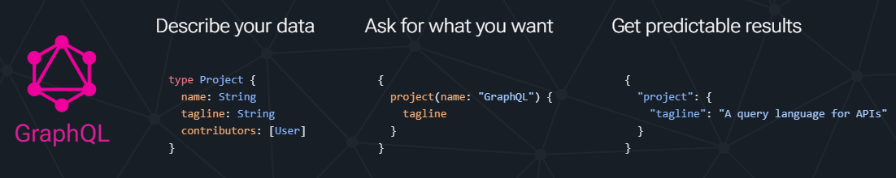

# GraphQL – Introduction

Créé par FB en 2012.

Pour afficher une page devaient faire des 10N d'appels API (REST et autres)

- X posts avec commentaires, likes
- X amis
- X vidéos
- …

Bref, ils ont atteint les limites des API Rest :
impossible de demander en 1 seule requête
« je veux les posts 7, 8 et 12, les amis 6 et 42, la vidéo 16 ».

Et toutes ces requêtes, ça prend du temps, des ressources ;
sans parler, des développeurs qui doivent connaître toutes ces API.

## C'est quoi

> <https://graphql.org/learn/>

- un **langage** de requêtes
- un **environnement d'exécution** qui utilise un système de type pour nos données

Des [implémentations de serveurs](https://graphql.org/community/tools-and-libraries/?tags=server)
GraphQL, il en existe de nombreux ; pour presque tous les langages.

> **NOTE** côté JS, l'un des plus populaires :
> [Apollo Server](https://www.apollographql.com/docs/apollo-server)

### Avantages

- **Flexibilité** : le client spécifie les champs dont il a besoin
- **Optimisation** : une seule requête peut récupérer des données de plusieurs sources
- **Typage fort** : grâce au schéma GraphQL qui définit les types de données

### Différence avec API RESTful

| Critère    | REST                                       | GraphQL                                                     |
| ---------- | ------------------------------------------ | ----------------------------------------------------------- |
| _Endpoint_ | plusieurs (`/users`, `/posts`)             | 1 seul (`/graphql`)                                         |
| Requête    | chaque ressource a un endpoint dédié*      | 1 seule requête pour récupérer plusieurs ressources         |
| Réponse**  | fixe, souvent trop ou pas assez de données | retourne uniquement les champs demandés (pas de gaspillage) |
|            |                                            |                                                             |
| CRUD       | verbes (GET, POST, PUT, PATCH, DELETE)     | `query` et `mutation`                                       |

[*] en RESTful, pas de jointure : pour récupérer un utilisateurs et ses articles → 2 requêtes  
[**] en RESTful, une requête = une réponse « fixe » / avec GraphQL, la structure de la réponse est définie dans la requête

> [contraintes API REST](https://fr.wikipedia.org/wiki/Representational_state_transfer#Contraintes_architecturales)

### Cas d'usage

|                                               | REST  | GraphQL |
| --------------------------------------------- | :---: | :-----: |
| API simple et stable                          |   x   |         |
| Application mobile (faible bande passante)    |       |    x    |
| Requêtes complexes (beaucoup d'associations') |       |    x    |
| Streaming / Temps réel                        |       |    x    |
| Mise en cache HTTP simple                     |   x   |         |

## Fonctionnement

1. **Décrire les données**  
   → mise en place de schémas

2. **Définir des requêtes** pour récupérer des données

3. Mettre en place des **resolvers**  
   → fonction qui détermine comment récupérer les données

   - les utilisateurs sont dans Postgres (dataMapper)
   - les articles sont dans un fichier JSON
   - les commentaires sont dans une base Mongo

   → « pour récupérer ça, je dois faire ça »

   et fabrication de la réponse
