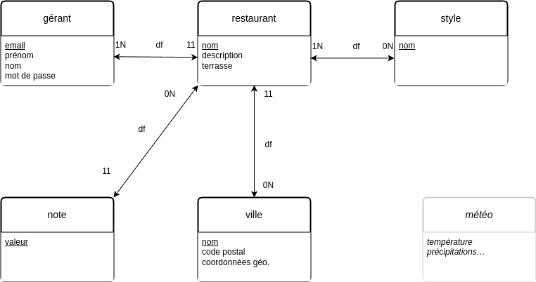

# GraphQL – Mise en place

On va se faire une API pour nos restaurants.

## Conception

### Entités

- **RESTAURANT** :
  - nom
  - description
  - terrasse

- **STYLE** :
  - nom (italien, chinois)

- **VILLE** :
  - nom
  - code postal
  - coordonnées géographiques

- **GÉRANT** :
  - nom
  - prénom
  - email
  - mot de passe

- **NOTE** :
  - valeur (de 1 à 5 par exemple)

> à côté de ça, on voudra aussi avoir la **météo de la ville** (température, précipitations…)

### Associations

- un GÉRANT possède au moins un RESTAURANT → 1N
- un RESTAURANT est possédé par un seul GÉRANT → 11

- un RESTAURANT propose au moins un STYLE → 1N
- un STYLE peut être proposé par plusieurs RESTAURANT → 0N

- une VILLE peut accueillir plusieurs RESTAURANT → 0N
- un RESTAURANT est accueilli dans une seule VILLE → 11

- une NOTE évalue un seul RESTAURANT → 11
- un RESTAURANT peut être évalué par plusieurs NOTE → 0N

### MCD



> **NOTE** les DBA, régulièrement, utilise « df » au lieu du verbe d'association :
> « dépendance fonctionnelle »

## Base de code

Je vais vous fournir du code… On regarde ça ensemble.

### Docker

On met en place un Docker Compose avec 2 services :

- une BDD Postgres
  - `init-oresto-db/` → dossier à lancer quand la BDD est prête

    > **RAPPEL**
    >
    > - `DOMAIN` : type de données personnalisé, contrainte pour restreindre
    > les valeurs autorisées dans un champ
    >
    > - `VIEW` : « bookmark » de requête  
    >   → récupère les restaurants avec leur note moyenne et le nombre de votes
    >
    >   → `COALESCE(..., 0.0)` : si le restaurant n'a aucune note, `0.0`
    >
    > **NOUVEAUTÉ**
    >
    > [`POINT`](https://www.postgresql.org/docs/current/datatype-geometric.html#DATATYPE-GEOMETRIC-POINTS)
    > est une type qui contient 2 valeurs numériques  
    > → parfait pour les coordonnées géographiques

- un serveur GraphQL
  
  > **NOTE** pour m'assurer que le conteneur BDD réponde bien, j'utilise le
  > _healthcheck_ [pg_isready](https://www.postgresql.org/docs/current/app-pg-isready.html)
  > avant de lancer le serveur

  - `Dockerfile` → Node + PNPM

### Génération des données

On utilise [Faker](https://fakerjs.dev/guide/)
avec un [script](./template/src/data-generation/seeding.mjs)
de génération de données !

#### Configuration et exécution

`package.json` → `pnpm init` + installation de :

- `@faker-js/faker`
- `debug`

→ `DEBUG=* node ./data-generation/seeding.mjs`

> [debug](https://www.npmjs.com/package/debug) est probablement LE paquet le plus
> utilisé dans l'environnement Node :
>
> - plus de 340_000_000 téléchargements par semaine
> - plus de 56_000 paquets s'en servent
>
> Il se substitue à `console.log` en y ajoutant des **_namespace_s**
> pour cibler facilement l'affichage des _logs_.  
> Et autre avantage, il n'affiche aucun _log_ en production !
> Il faut l'**activer grâce à une variable d'environnement** pour qu'il « fonctionne »
> (sinon la fonction `debug` est remplacée par une fonction qui ne fait rien – `noop()`)

Générer les données en :

1. se rendant dans `src` → `cd src/`
2. lançant le script dédié → `pnpm seed`

### `index.ts`

```ts
// @file `./src/index.ts`
import debug from 'debug';

const log = debug('app:server');
log('We are ready!!!');

```

## C'est parti

On n'oublie pas le `.env`…

On lance tout !!!
→ `docker compose up --build`
